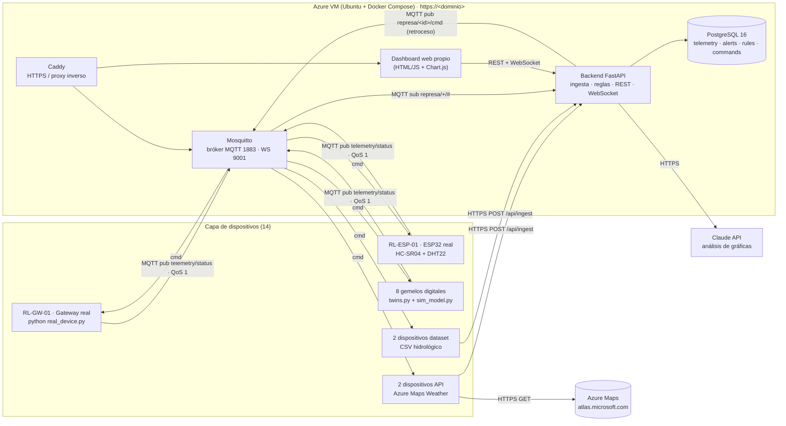

# Represa Sogamoso · Plataforma IoT de monitoreo y control

Proyecto final (Capstone) de IoT: instrumentación de una represa hidroeléctrica en **Betulia, Santander**
(embalse del río Sogamoso). 14 dispositivos (reales, gemelos digitales, API y dataset) envían datos por
**MQTT** y **HTTPS REST** a una plataforma propia desplegada en una VM de **Azure** con dominio propio,
con almacenamiento en PostgreSQL, reglas de alerta, un dashboard web propio en vivo y análisis de las
gráficas con IA. Todos los dispositivos aceptan **retroceso** (encender/apagar, intervalo, calibración,
consignas y modo).

## Arquitectura de referencia



| Capa | Componente | Tecnología |
|---|---|---|
| Percepción | Sensores reales, gemelos digitales, API y dataset | Python 3.12 (paho-mqtt, psutil, requests), MicroPython |
| Transporte | Bróker de mensajería | Eclipse Mosquitto 2 (MQTT 3.1.1/5, TCP 1883 y WebSockets 9001) |
| Transporte | Ingesta HTTP | REST JSON sobre HTTPS (`POST /api/ingest`, encabezado `X-API-Key`) |
| Plataforma | Backend, reglas y retroceso | FastAPI + aiomqtt + asyncpg |
| Datos | Series de tiempo, alertas, reglas, comandos | PostgreSQL 16 |
| Aplicación | Dashboard propio y análisis IA | HTML/CSS/JS + Chart.js, Claude API |
| Infraestructura | Nube y dominio propio | Azure VM + IP pública con etiqueta DNS, Docker Compose, Caddy (Let's Encrypt) |

## Dispositivos, variables y rangos

| ID | Dispositivo / sensor | Tipo | Protocolo | Variables (rango) |
|---|---|---|---|---|
| RL-GW-01 | Gateway de borde (PC/Raspberry, psutil) | Real | MQTT | CPU 0–100 %, RAM 0–100 %, disco 0–100 %, red 0–5000 kB/s, latencia al bróker 0–500 ms |
| RL-ESP-01 | ESP32 + HC-SR04 + DHT22 (maqueta de vertedero) | Real (opcional) | MQTT | nivel 0–40 cm, temperatura 0–50 °C, humedad 0–100 % |
| DT-NIV-01 | Sensor de nivel radar del embalse | Gemelo digital | MQTT | nivel 290–335 msnm, volumen 2500–4800 hm³, caudal de entrada 100–2500 m³/s |
| DT-PZ-01 | Piezómetro de cuerda vibrante | Gemelo digital | MQTT | presión de poro 200–1000 kPa, temperatura 12–25 °C |
| DT-INC-01 | Inclinómetro biaxial + extensómetro | Gemelo digital | MQTT | inclinación X/Y −5–5 mm/m, desplazamiento 0–20 mm |
| DT-COMP-01 | Compuerta radial del vertedero (actuador) | Gemelo digital | MQTT | apertura 0–100 %, consigna 0–100 %, corriente motor 0–60 A, caudal vertido 0–4200 m³/s |
| DT-TURB-01 | Turbina Francis + generador | Gemelo digital | MQTT | potencia 0–280 MW, caudal turbinado 0–700 m³/s, 0–200 rpm, rodamiento 30–90 °C |
| DT-SIS-01 | Acelerógrafo triaxial | Gemelo digital | MQTT | PGA 0–0.3 g, frecuencia 0.5–20 Hz, vibración 0–10 mm/s |
| DT-CAL-01 | Sonda multiparamétrica de calidad de agua | Gemelo digital | MQTT | pH 6–9, turbidez 0–300 NTU, OD 2–10 mg/L, temperatura 18–30 °C |
| DT-FIL-01 | Aforador de filtraciones | Gemelo digital | MQTT | filtración 0–100 L/s, turbiedad 0–50 NTU |
| API-WX-01 | Azure Maps · Current Conditions | API | HTTPS REST | temperatura, sensación térmica, humedad, presión, viento, lluvia 1 h, UV, nubosidad |
| API-AQ-01 | Azure Maps · Air Quality | API | HTTPS REST | ICA 0–300, PM2.5, PM10, O₃, NO₂, CO (µg/m³) |
| DS-RIO-01 | Estación hidrométrica aguas arriba (CSV) | Dataset | HTTPS REST | caudal del río 100–2000 m³/s, nivel 0–10 m |
| DS-PLU-01 | Pluviómetro de la cuenca (CSV) | Dataset | HTTPS REST | precipitación 0–15 mm/10 min, acumulado 24 h 0–120 mm |

El catálogo completo (etiquetas, unidades, rangos y controles) vive en [db/init.sql](db/init.sql).

**Gemelos digitales.** Los 8 gemelos comparten un modelo físico ([devices/sim_model.py](devices/sim_model.py)):
lluvia de tarde → escorrentía retardada → caudal de entrada → balance hídrico del embalse (entrada − turbinado −
vertido) → presión de poro (con retardo de 12 h) y desplazamiento de la cortina; la demanda eléctrica diaria
mueve la potencia y la temperatura de los rodamientos; hay microsismos ocasionales (nido de Bucaramanga) que
se reflejan en PGA, vibración y filtraciones. Por eso las consignas de retroceso cambian la física: abrir la
compuerta aumenta el caudal vertido y baja el nivel.

**Dataset.** [devices/data/dataset_hidrologico.csv](devices/data/dataset_hidrologico.csv) tiene 6 días con una fila cada
10 min por estación (generado con `gen_dataset.py`). Puede reemplazarse por un CSV real del IDEAM
(datos.gov.co) con las mismas columnas.

## Comunicación: bróker y protocolo

**Bróker:** Eclipse Mosquitto 2, autenticación usuario/contraseña (`allow_anonymous false`), persistencia
activada, escucha MQTT en TCP 1883 y MQTT sobre WebSockets en 9001 (publicado como `wss://<dominio>/mqtt`).

**Tópicos** (raíz `represa/<id_dispositivo>/…`):

| Tópico | Sentido | QoS / retain | Contenido |
|---|---|---|---|
| `represa/<id>/telemetry` | dispositivo → bróker → backend | 1 / no | `{"ts": "...", "seq": 42, "values": {"nivel_msnm": 318.6, ...}}` |
| `represa/<id>/status` | dispositivo → backend | 1 / **sí** | estado actual (power, interval, offsets, gains, mode, setpoint). **LWT**: `{"online": false}` |
| `represa/<id>/cmd` | backend → dispositivo (retroceso) | 1 / no | `{"id": "<uuid>", "action": "setpoint", "value": 35}` |
| `represa/<id>/ack` | dispositivo → backend | 1 / no | `{"cmd_id": "<uuid>", "ok": true, "msg": "apertura objetivo 35 %"}` |

Los dispositivos API y dataset envían sus lecturas por **HTTPS REST** (`POST /api/ingest` con `X-API-Key`) y
reciben el retroceso por MQTT igual que los demás. El dashboard recibe los datos en vivo por **WebSocket** (`/ws`).

**Acciones de retroceso:** `power` (on/off), `interval` (1–3600 s), `calibrate` (`{variable, gain, offset}`:
valor × ganancia + offset), `reset` (valores de fábrica), `setpoint` (apertura de compuerta %, potencia MW,
fila del dataset) y `mode` (auto/manual en compuerta y turbina). Cada comando queda en la tabla `commands`
con su acuse.

## Procesamiento y visualización

- **Dashboard propio** (`https://<dominio>/`): KPIs con último valor, promedio, mínimo y máximo del rango;
  gráfico por dispositivo/variable (línea = promedio por ventana, banda = mín–máx); selector de tiempo
  1 h / 6 h / 24 h / 3 d / 5 d / personalizado; tarjetas por dispositivo con modal de control; alertas; reglas
  editables; análisis con IA.
- **Reglas y alertas:** umbrales por variable (`>`, `<`, `>=`, `<=`) con severidad advertencia/crítica y
  enfriamiento de 10 min, evaluadas en cada lectura (ver `rules` en [db/init.sql](db/init.sql)).
- **Análisis con IA:** `GET /api/analysis?range=5d` resume cada variable (promedio, mín./máx. con hora,
  tendencia y perfil en 24 ventanas) y las alertas, y pide a Claude (`claude-opus-5-5`) una descripción del
  comportamiento de las gráficas. Sin `ANTHROPIC_API_KEY` devuelve un resumen estadístico local.
- **Exportar datos:** `GET /api/export.csv?device_id=DT-NIV-01&range=5d` para gráficas del documento.

## API REST

| Método | Ruta | Descripción |
|---|---|---|
| GET | `/api/devices` | catálogo, estado y últimos valores |
| GET | `/api/series?device_id&variable&range=24h` | serie agregada (avg/min/max por ventana) |
| GET | `/api/stats?range=5d` | promedio, mín., máx., desviación y conteo por variable |
| GET | `/api/alerts?range=24h` | alertas del rango |
| GET/POST/PUT | `/api/rules` | reglas de alerta (escritura con `X-Admin-Token`) |
| POST | `/api/devices/{id}/command` | retroceso (`X-Admin-Token`) |
| GET | `/api/commands?device_id` | bitácora de comandos y acuses |
| POST | `/api/ingest`, `/api/ingest/batch` | ingesta HTTP (`X-API-Key`) |
| GET | `/api/analysis?range=5d` | análisis con IA (`X-Admin-Token`) |
| WS | `/ws` | eventos en vivo: telemetry, status, alert, ack |

## Despliegue en Azure (URL propia)

1. **VM:** crear una VM Ubuntu 24.04 (B2s o superior). En *Redes* abrir los puertos **80, 443 y 1883**.
2. **Dominio propio:** en la IP pública de la VM → *Configuración* → *Etiqueta de nombre DNS*, p. ej.
   `represa-santander` → `represa-santander.<región>.cloudapp.azure.com`.
3. **Docker:**
   ```bash
   curl -fsSL https://get.docker.com | sudo sh && sudo usermod -aG docker $USER && newgrp docker
   ```
4. **Código y configuración:**
   ```bash
   git clone <repo> represa-iot && cd represa-iot
   cp .env.example .env && nano .env   # DOMAIN, contraseñas, AZURE_MAPS_KEY
   ```
   `DOMAIN=represa-santander.<región>.cloudapp.azure.com`.
   Caddy obtiene el certificado HTTPS automáticamente.
5. **Arranque** (opcionalmente con 5 días de histórico de gemelos y dataset para probar):
   ```bash
   docker compose up -d --build db mosquitto backend caddy
   docker compose run --rm twins python seed_history.py --days 5   # opcional, una sola vez
   docker compose up -d --build
   ```
6. **Dispositivo real** desde un PC o Raspberry Pi:
   ```bash
   cd devices && pip install -r requirements.txt
   python real_device.py --host represa-santander.<región>.cloudapp.azure.com --user represa --password <MQTT_PASS>
   ```
7. **ESP32 (opcional):** editar Wi-Fi y bróker en [devices/esp32/main.py](devices/esp32/main.py) y copiarlo a la placa.

Deje la plataforma corriendo **4 a 6 días** para que el gateway real y los dispositivos de Azure Maps acumulen
datos reales; los gemelos y el dataset generan datos continuamente.

**Prueba local:** con `DOMAIN=:80` en `.env`, los mismos comandos sirven el dashboard en http://localhost.

## Estructura

```
backend/        FastAPI (app/main.py, app/analysis.py) + dashboard estático (static/)
devices/        common.py (clase base MQTT/HTTP + retroceso), sim_model.py, twins.py, api_bridge.py,
                dataset_player.py, gen_dataset.py, seed_history.py, real_device.py, esp32/main.py
db/init.sql     esquema, catálogo de dispositivos y reglas
mosquitto/      configuración del bróker
caddy/          proxy inverso HTTPS
```

## Referencias

- Microsoft. *Azure Maps Weather REST API (2025-01-01)*. https://learn.microsoft.com/es-es/rest/api/maps/weather
- Eclipse Foundation. *Eclipse Mosquitto: An open source MQTT broker*. https://mosquitto.org/
- OASIS. *MQTT Version 5.0 / 3.1.1*. https://mqtt.org/mqtt-specification/
- FastAPI. https://fastapi.tiangolo.com/ · PostgreSQL. https://www.postgresql.org/docs/16/
- Caddy. *Automatic HTTPS*. https://caddyserver.com/docs/automatic-https
- Anthropic. *Claude API*. https://docs.claude.com/
- IDEAM. *Datos hidrometeorológicos abiertos*. https://www.datos.gov.co/
# DashboardRepresaIOT

